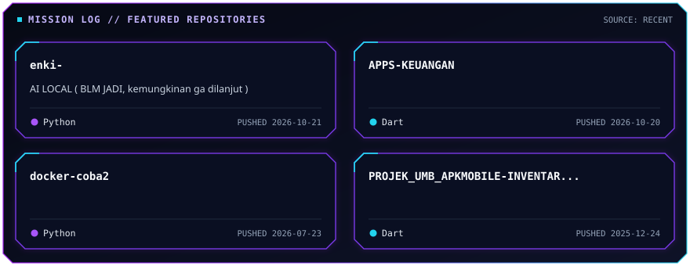

  

  

<table>
  <tr>
    <td width="260" align="center" valign="middle">
      
    </td>
    <td valign="middle">
      <h3>Halo, gua Abid (abdzki)</h3>
      

        Mahasiswa Teknik Informatika yang lagi fokus ngulik Data Science dan Business Intelligence.
        Di GitHub ini isinya campuran project Python, aplikasi mobile Flutter, eksperimen AI lokal, sampai tugas kuliah yang sekalian gua rapihin.
      

      

        Di luar layar kode, gua suka nulis cerita dan punya rencana panjang buat jadi writer-director.
        Kalau lagi istirahat dari data dan deadline, biasanya mampir sebentar ke Minecraft.
      

      

        Terbuka buat ngobrol soal data, bikin aplikasi kecil-kecilan, atau kolaborasi kreatif.
      

    </td>
  </tr>
</table>

<h3>Tech Stack</h3>

  

<!-- STACK_ICONS:START -->

  

  
  
  
  

<!-- STACK_ICONS:END -->

<h3>Featured Projects</h3>

  

<!-- PROJECTS_LINKS:START -->

  <a href="https://github.com/1AbidD/enki-">enki-</a> &nbsp;&middot;&nbsp; <a href="https://github.com/1AbidD/APPS-KEUANGAN">APPS-KEUANGAN</a> &nbsp;&middot;&nbsp; <a href="https://github.com/1AbidD/docker-coba2">docker-coba2</a> &nbsp;&middot;&nbsp; <a href="https://github.com/1AbidD/PROJEK_UMB_APKMOBILE-INVENTARIS-UKM-">PROJEK_UMB_APKMOBILE-INVENTARIS-UKM-</a>

<!-- PROJECTS_LINKS:END -->

<h3>GitHub Telemetry</h3>

  
  

<h3>Contribution Orbit</h3>

  

  

  
  <!-- TODO: Replace with your real Instagram link and remove the placeholder badge -->
  
  <!-- TODO: Replace with your real mailto: address and remove the placeholder badge -->
  

  
Profile maintenance notes

  

    Tech stack and featured projects sync daily via <code>.github/workflows/update-stack.yml</code> using <code>scripts/gen_stack.py</code>.
    The contribution snake updates daily via <code>.github/workflows/snake.yml</code>.
    To swap the Minecraft placeholder avatar, set <code>MC_USERNAME</code> in <code>scripts/make_mc_svg.py</code> or place a local <code>skin.png</code> in the repo root and run <code>python scripts/make_mc_svg.py</code>.
  

